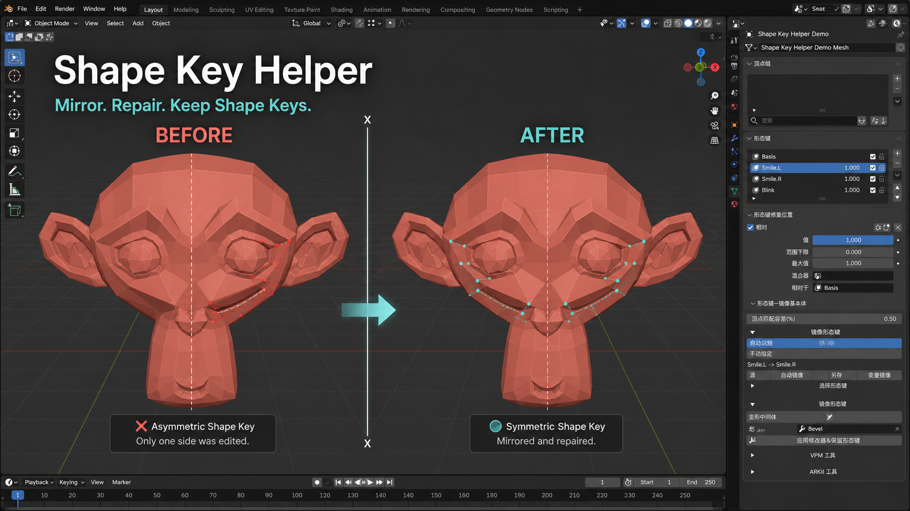
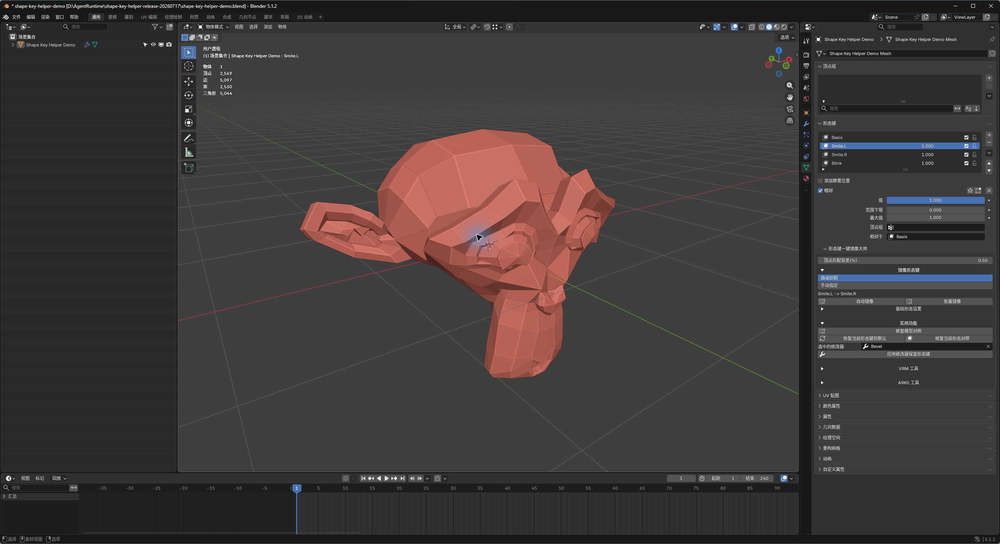

# Shape Key Helper

[简体中文](README_zh_CN.md)

Shape Key Helper is a Blender extension for mirroring shape keys, repairing
symmetry, and applying modifiers without losing existing shape keys.

The comparison above shows an asymmetric facial shape key repaired across the
mesh X axis. The original mesh and its UVs stay intact.

## Interface

The screenshot uses Blender's Simplified Chinese interface. The extension ships
with English source labels and Simplified Chinese translations.

## Features

- Mirror the active left/right shape key automatically
- Choose source and target shape keys manually
- Batch mirror matching keys across selected mesh objects
- Repair a visually symmetric mesh without deleting half of it or changing UVs
- Repair only the active shape key or reset it to the base shape
- Apply one modifier while preserving relative or absolute shape keys
- Preserve shape key names, order, values, mute states, vertex groups,
  relative-key links, animation actions, and drivers
- Add and repair ARKit 52 shape keys
- Assist VRM0 default expression and Blend Shape Proxy setup
- English interface with Simplified Chinese translations

## Requirements

- Blender 5.1 or newer
- A mesh object for symmetry and modifier tools
- Existing shape keys for mirror, reset, and active-key repair tools

## Installation

1. Download the release ZIP.
2. Open Blender Preferences > Get Extensions.
3. Open the menu and choose Install from Disk.
4. Select the ZIP and enable Shape Key Helper.

## Quick Start

1. Select a mesh and open Object Data Properties > Shape Keys.
2. Expand Shape Key Helper below Blender's shape key panel.
3. Use Mirror Shape Keys for automatic, manual, or batch mirroring.
4. Use Utility Tools for mesh repair, active-key repair, reset, or modifier
   application.

## Modifier Safety

The modifier tool evaluates the basis and every shape key through the same
selected modifier. Other visible modifiers are temporarily disabled. The
operation is cancelled before replacing the mesh if evaluated vertex counts
are inconsistent.

Back up production files before topology-changing operations. Shape key NLA
tracks are not rebuilt yet; remove or bake those tracks before applying a
modifier with this tool.

## Privacy and Permissions

The extension does not request network, file, clipboard, camera, or microphone
permissions.

## License

Shape Key Helper is licensed under the GNU General Public License v3.0 or
later. See [LICENSE](LICENSE).
